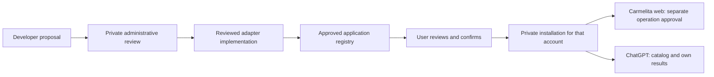

# Personal applications: local pilot handoff

This candidate separates service review, the application registry and each user's installation. A developer proposal is private and requires administrative review. Accepting it for a pilot does not publish an adapter or add it to everyone's account. The only implemented adapter is the registered `bazaar-v1` profile; submitted URLs or skill instructions never become executable code.

The Carmelita branch `codex/personal-apps-bazaar` starts from the local access-design candidate `52075c6`, preserving the separate landing branch. The companion Bazaar branch `codex/carmelita-consumer-pilot` uses the reviewed recovery baseline `e14037e` and consumer commit `a147d88`. Neither branch has been pushed or merged into production.



## Implemented journey

1. A developer submits the existing `/developers#proposal` form. `/admin/integrations` supports pending, in-review, rejected and accepted-for-pilot decisions with a private reason, reviewer, date and optimistic version. Repeated identical decisions are idempotent.
2. `/admin/apps` reviews the registered adapter separately. Approval and suspension require its version, approval revision and an evidence reference. There is no arbitrary endpoint registration or automatic publication.
3. An authenticated user opens `/apps`, reviews an approved application and confirms adding or removing it. The same owner record is used from Carmelita and the MCP. Account switches discard late responses from the previous session.
4. Bazaar enrollment creates one private external profile automatically. Lost responses and partial enrollment retain the creation identifier. Removal blocks local access immediately and reports unfinished remote revocation. Reconnection rotates access while retaining the profile.
5. Bazaar's current catalog is paginated and refreshed from its fixed upstream origin. Six existing Bazaar queries require the caller's active personal installation. Other providers and core wallet reads retain their contracts.
6. The Guionista Testnet consumption pilot is separate from installation. Web preparation freezes service, input, price, Stellar network, recipient, payer and expiry. The user explicitly signs those terms. Durable submission state prevents a second signed POST after uncertainty; recovery checks the same operation identifier.

## ChatGPT boundary

`agent:read` remains the default scope. App management additionally requires explicitly granted `agent:services:manage`; existing sessions are not silently expanded. The MCP Apps component holds the single-use confirmation token in UI-only metadata and exposes confirm, cancel and retry tools only to the component. Preparing a change does not install it.

ChatGPT can read the installed catalog and the owner's existing orders/results. Its separate Bazaar grant has no order-creation, challenge or payment-submission scopes. Native results omit purchase descriptors, checkout links and signing material. Reads do not wake Guionista, prepare a payment, execute a service or mutate the history. Returned service text is marked untrusted.

## Publication prerequisites

Both features are disabled by default. Do not enable them during local review:

| System | Configuration | Meaning |
| --- | --- | --- |
| Bazaar | `BAZAAR_ENABLE_CONSUMERS` | Enables the private consumer contract |
| Carmelita | `CARMELITA_BAZAAR_APPS_ENABLED` | Enables remote enrollment for the fixed adapter |
| Carmelita | `CARMELITA_BAZAAR_WEB_CONSUMPTION_ENABLED` | Enables web preparation/submission independently |

Before any authorized publication, review Vercel build costs and select the two candidate commits. Update **all Bazaar workspace-v1 readers** before enabling consumers: older strict readers reject the new optional `consumerEnrollment` field. Apply Carmelita migration `0022_personal_apps` explicitly to an isolated QA database first; GET handlers never create schema. Verify `CONNECTOR_ENCRYPTION_KEY`, Stytch's optional management scope and the re-consent flow without exporting their values.

Approve the fixed adapter only after the consumer contract, scopes and ownership behavior pass hosted QA. Verify facilitator admission, seller availability, the exact Stellar Testnet USDC issuer/SAC, wallet activation, trustline and balance. The existing maximum is **0.01 USDC**; a more expensive upstream service is rejected, not silently allowed. XLM is Stellar's native asset and does not require a trustline. A service listing or order alone is not confirmed payment.

Review privacy disclosures for external profile creation, credential storage and input/result retention before inviting real users. Operation content has a seven-day limit. The explicit authenticated admin maintenance route `/api/admin/apps/maintenance` accepts `prune-expired-inputs`; it removes saved input, challenge and authorization, preserving minimal recovery metadata. It is not a configured scheduled job. Deployment operations must schedule and monitor it; ChatGPT GETs do not trigger cleanup. Provider result retention is enforced independently by Bazaar.

Disabling web consumption stops new preparation/submission while leaving read/recovery paths available. App suspension/removal blocks future application access. Uncertain operations must retain their identifiers and be reconciled before another payment; never reset them or replace them with new orders as a rollback shortcut.

## Verification and remaining acceptance

Run locally with synthetic owners and no production environment files:

```powershell
node scripts/test-personal-apps.mjs
node scripts/test-personal-apps-contract.mjs ../bazaar-consumer-pilot
npm run qa:local
```

The required SQL runner executes the real mutation function and constraints in pinned PGlite. Cross-repository conformance runs Carmelita's actual provisioner against Bazaar's native consumer handlers with an isolated CAS store. Global external fetch is blocked. Local UI fixtures use real components, synthetic HTTP responses and disabled signing; they are not real account, provider or payment acceptance.

The external acceptance still requires two people: native ChatGPT confirmation, fresh management consent, mobile use, separate catalogs/history, cancellation, removal/reconnection, expired/revoked access and lost-response recovery. The purchase pilot additionally requires a real approved Testnet signature, confirmed payment, delivery and recovery of the same result. No Mainnet acceptance is included.

Local browser review covers EN/ES/PT, 320/390/768/1024/1440 px, dialog focus and Escape, a delayed reply during account change, partial catalog handling, explicit native-component cancellation/retry and fencing an old native response after a new preview. No horizontal overflow was observed. Browser zoom shortcuts did not change the in-app browser viewport, so actual 200% browser zoom remains a manual check; narrow-viewport reflow is not recorded as equivalent zoom acceptance.

See [backend and recovery contract](personal-apps-backend.md), [source acceptance status](personal-apps-acceptance.md) and the companion Bazaar checkout's `docs/CONSUMER_INTEGRATION.md`. The 50 current read definitions remain pending operational acceptance on this changed candidate; historical evidence is preserved. No push, merge, hosted build, production migration or payment is part of this local handoff.
